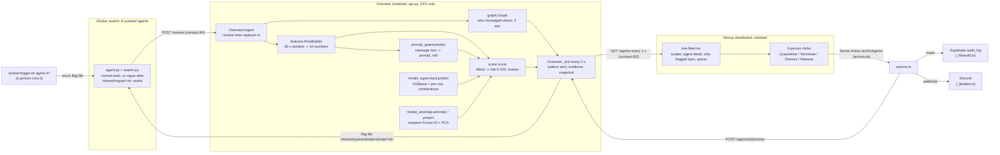

# Sentinel pre-submission audit

Audited: `origin/main` at `18333e3`, 2026-11-14 about 18:00 UTC. No application code was changed. Fixes are proposed here and spelled out step by step in [FIX-INSTRUCTIONS.md](FIX-INSTRUCTIONS.md).

**Verdict: GO for the live demo, on four conditions** (section 1d, findings B1-B4). The software works. The risk is in what we say and show around it: one sentence on the dashboard and four numbers on the deck would not survive a careful judge as they stand.

Where the plan and the code disagree, this report trusts the code and lists the difference in section 1e.

---

## 1a. Architecture

| Step | What happens | File that owns it |
|---|---|---|
| 1. Swarm | 8 containers from one image run a scripted agent. Normal: one in-role tool call or message every ~6.5 s. Rogue: decoy touches, out-of-scope calls, 4 injected messages per step to one peer | `docker/agent/swarm.py`, `docker/agent/agent.py`, `docker/compose.yml` |
| 2. Trigger | A person creates `/shared/rogue/<id>` inside the agent's container | `docker/trigger.sh` |
| 3. Events in | `POST /events`; the overseer overwrites `ts` with its own clock and keeps per-agent counters | `_py/api.py` (`Event`, `Overseer.ingest`) |
| 4. Features | Each agent's last 60 s becomes one row of 10 numbers, plus optional `prompt_risk` | `_py/features.py` (`RowBuilder`, `window_row`) |
| 5a. Known attacks | XGBoost gives `p_attack`, a label and the top per-row contributions | `_py/model_supervised.py` |
| 5b. Unusual behaviour | Isolation Forest #2 gives a 0-1 anomaly score; PCA gives the dot position | `_py/model_anomaly.py` |
| 5c. Message text | TF-IDF + logistic regression gives an injection probability per message | `_py/prompt_guard.py` |
| 6. Blend | `risk = round(max(0.65*S + 0.35*A, 0.85*S, 0.8*A, 0.9*P))`; reason sentence; tier | `_py/score.py`, tiers in `_py/contract.py` |
| 7. Spread | Message counts over 5 minutes; `likely_infected` = 10+ messages and partner risk 40+ | `_py/graph.py` |
| 8. Fleet state | Every 2 s: score every agent, name patient zero (first to reach 75), build evidence, publish the snapshot | `_py/api.py` (`Overseer._tick`, `_commit_agent`, `_evidence`) |
| 9. Dashboard | Polls `GET /agents` every second; falls back to the recording until the overseer answers | `src/app/sentinel/live-fleet.tsx`, `page.tsx`, `_components/*` |
| 10. Why flagged | `agents[].top_features` drawn as bars | `_components/why-flagged.tsx`, shown from `_components/agent-detail.tsx` |
| 11. Human decision | Per-agent buttons call a Server Action | `_components/agent-actions.tsx`, `_components/agent-queue.tsx`, `actions.ts` (`actOnAgents`) |
| 12. Containment | The overseer writes a flag file the agent obeys; Release removes it | `_py/api.py` (`Overseer.act`, `_write_flags`), `docker/agent/agent.py` |
| 13. Audit + alert | One insert per agent per click; one Discord message | `_lib/audit.ts`, `_lib/alert.ts`, `supabase/migrations/20261114000000_audit_log.sql` |

Isolation Forest #1 (`model_anomaly.filter_train`) is not on this path: it runs once at training time to drop junk rows from the training split.

---

## 1b. Correctness

### Commands run

| Check | Result |
|---|---|
| `pnpm install` | Clean. Lockfile up to date |
| `pnpm check` (eslint + `tsc --noEmit`) | **Pass**, 0 errors, 0 warnings |
| `pnpm build` (Next 16.4.6, Turbopack) | **Pass**, 0 warnings. `/sentinel` and `/` are static; `/example`, `/login`, `/api/health` dynamic |
| `cd src/app/sentinel/_py && python -m pytest -q` (Python 3.11) | **154 passed**, 0 failed, 1 warning (Starlette deprecation of `httpx` in the test client; harmless) |
| `python model_anomaly.py`, `model_supervised.py`, `score.py --report` | All run; numbers in section 1f |
| `python prompt_guard.py` | Skips with a warning: `data/real/prompt_safety.parquet` is not in git (by design) |
| Live stack on this laptop | `GET /health` -> `{"ok":true,"mode":"live","backend":"modules"}`; 8 agents reporting; `components.fallback=false` |

Running the tests natively on macOS needs the OpenMP library for XGBoost (`brew install libomp`). The README does not say so. Inside Docker it is already installed.

### Contract drift (`_py/contract.py` vs `_lib/contract.ts`)

No mismatch in anything the code uses. Compared by value: attack types (6), actions (4), verdicts, roles, containment states, the four tiers and their bounds (0-39, 40-74, 75-94, 95-100), `THROTTLE_AT` / `QUARANTINE_AT` / `TERMINATE_AT`, the 13 feature-row columns and their order, `TEXT_MAX_CHARS` (2000), agent statuses, agent actions, the evidence shape, the `/score` and `/agents` shapes. `api.py`'s pydantic models match both.

Small differences, none breaking:

1. `POST /decision` takes `"approve" | "dismiss"`; the TypeScript `Decision` type is `"approved" | "dismissed"`. The dashboard never calls `/decision`, so nothing breaks (finding M4).
2. `contract.ts` has no `TASK_MAX_CHARS`, `EVENT_KINDS`, `WINDOW_S`, `TICK_S`, `GRAPH_WINDOW_S` or `INFECTED_MIN_MESSAGES`. The dashboard hard-codes "10 or more messages and a risk of 40 or more" in `_components/related-agents.tsx:24-25`.
3. `api.py` re-declares `TEXT_MAX_CHARS`, `WINDOW_S`, `EDGE_WINDOW_S`, the tier function and the literals 40 and 75 instead of importing them from `contract.py` (`api.py:41-44, 64-72, 432, 644-656`). A test checks `TEXT_MAX_CHARS` only.
4. The contract allows up to 5 `top_features`; `model_supervised.TOP_K` is 3, so the dashboard shows at most 3 bars.

### SHAP path, end to end: works

`model_supervised.predict` (`model_supervised.py:158-181`) calls XGBoost with `pred_contribs=True` and returns the largest positive contributions toward the most likely attack class -> `api.py` `explain()` (`api.py:479-488`) runs for every agent at risk 40+ (`api.py:593-599`) -> `AgentState.top_features` -> `GET /agents` -> `agent-detail.tsx:104` renders `<WhyFlagged>` -> bars in `why-flagged.tsx`.

Confirmed in the recording: tick 69 has `agent-47: msgs_to_agents_per_min +1.919, touched_decoy +1.398, failed_calls_per_min +0.362`.

Things to know before pointing at the bars:

- The bars are XGBoost's built-in per-row contributions (TreeSHAP), in log-odds units. Say "feature contributions" or "SHAP values from XGBoost". The `shap` Python package is not used.
- Only positive pushes are returned, so the grey "toward normal" bars described on screen (`why-flagged.tsx:43`) essentially never appear.
- The bars explain the classifier only. They do not include the anomaly model or Prompt Guard.
- The reason sentence is **not** built from SHAP. It ranks how far each feature is above the clean baseline; SHAP's top 2 only break ties with a 1.5x boost (`score.py:236-258, 341`). The README says the contributions "become the plain-language reason", which is not what the code does.

### Live loop after the Prompt Guard and real-data merges: works

- `score.py` with `prompt_risk` absent: `_prompt()` returns `None`, the blend uses 0, and `components.prompt` is omitted (`score.py:113-124, 319-356`). Covered by tests and by `POST /score` with `exclude_none`.
- Prompt Guard artifact missing: `features.PromptScorer` logs one warning, retries every 30 s, and `prompt_risk` stays 0 (`features.py:94-121`). Scoring continues. **This is the state of the overseer running on this laptop now** (finding B2).
- Demo mode with no network: `page.tsx` imports `_data/demo_timeline.json` at build time; with `NEXT_PUBLIC_DEMO_MODE=1` the page never fetches. 70 ticks, real recording, includes `top_features`, `evidence` and `task`. Works.

### Things that could go wrong on stage

No code path throws to the user. Each failure degrades to a message. The messages are the problem:

| Situation | What the audience sees | Where |
|---|---|---|
| Always, today | A card titled "Results" that says "The validation runs have not been done yet." | `page.tsx:28`, `results-panel.tsx:12` (B1) |
| No Supabase keys on the presenting laptop | After clicking Quarantine: "Demo mode: nothing written to the audit log." | `src/lib/demo.ts:8`, `_lib/audit.ts:28`, `actions.ts:60` |
| Audit migration not applied | "Audit log write failed: ..." | `_lib/audit.ts:32` |
| No `DISCORD_WEBHOOK_URL` | No alert, silently | `_lib/alert.ts:16` (B3) |
| Page opened by LAN IP instead of `localhost` | Stays on the recording: "Waiting for the overseer..." (CORS allows localhost origins only) | `api.py:859` |
| Overseer restarts mid-demo | "Overseer not answering; showing the last snapshot." then recovers | `live-fleet.tsx:178-181` |
| Model artifacts missing | Scores continue from the frequency-count fallback, `components.fallback=true`, no bars | `score.py:91-110, 346-352` |

### Dead code and leftovers

- `_components/recommendation.tsx` and `_components/patient-zero.tsx`: not imported anywhere.
- `actions.ts:90-118` `decide()`: not called. It still tells Discord "A person acts on it with docker/quarantine.sh".
- `_lib/response.ts:41-63` `throttled`, `secondsToDetect`, `headline`: not used outside the file.
- `POST /decision` (`api.py:559-573, 906-913`): used only by `record_timeline.py` and tests.
- `score.py:373-408` `stand_in_supervised`: its docstring says it will be replaced by Noah's model; it is still what the novel-attack check trains.
- `docs/handoffs/HANDOFF.md`: template text from before the hackathon ("Template preparation and MCP learning"). `REPO_STRUCTURE.md` and `ORCHESTRATION.md` are 0 bytes, and the README links to both.
- No `TODO` or `FIXME` markers in source. No unhandled promise rejections: the one fire-and-forget call swallows its error (`live-fleet.tsx:123`), which hides audit failures for Sentinel's own recommendation rows.

---

## 1c. Security and privacy

### Confirmed good

| Check | Result | Evidence |
|---|---|---|
| Committed secrets, current tree | None | Pattern scan for Supabase keys, JWTs, Discord and Slack webhooks, GitHub, OpenAI, AWS, Hugging Face tokens, private keys, Supabase project hosts |
| Committed secrets, all 113 commits on all branches | None | Same patterns with `git log --all -G` |
| `.env`, `.env.local` ignored | Yes | `.gitignore:34` (`.env*`, with `!.env.example`); only `.env.example` was ever committed |
| `audit_log` RLS | On, with one INSERT and one SELECT policy; no UPDATE or DELETE policy | `supabase/migrations/20261114000000_audit_log.sql:15-24` |
| Browser key | Publishable (anon) key only | `src/lib/supabase/client.ts`, `env.ts` |
| Secret key | Server only, never `NEXT_PUBLIC_`, `import "server-only"`, used by the template example only. Sentinel never loads it, and it is empty on this laptop | `src/lib/supabase/admin.ts`, `src/app/example/actions.ts` |
| Agents hold no secrets | Agent env is ids, role, peers, URLs, a task sentence | `docker/compose.yml:24-71`, `docker inspect` |
| Discord webhook validated | Strict regex on four Discord hosts and the `/api/webhooks/<id>/<token>` path; URL comes from env only; mentions disabled; 3 s timeout | `_lib/alert.ts:8, 15-24` |
| Overseer URL for the action call | Env only, never from the request; agent id checked by regex and URL-encoded | `actions.ts:137-141`, `_lib/response.ts:65` |
| Overseer port | `127.0.0.1:8000` only | `docker/compose.yml:38`, `docker inspect` |
| Containers non-root | Both run as uid 10001; not privileged; no added capabilities | `docker/overseer/Dockerfile:28-29`, `docker/agent/Dockerfile:9-10` |
| Docker socket | Mounted nowhere | `docker/compose.yml` |
| Path traversal on flag files | Blocked: `^agent-\d{1,4}$` checked twice | `api.py:51, 725, 920` |
| Message text | Scored, then dropped with its 60 s window. Never logged, never returned by an endpoint, never sent to Discord or Supabase | `api.py:90-92`, `features.py:140-152` |
| Audit rows | Hold agent id, risk, attack type, action, reason, and the user's id (never an email) | `actions.ts:23-24, 99, 175` |
| Nothing acts on its own | The only code that changes an agent is `Overseer.act`, reachable only from `POST /agents/{id}/action`, called only by `actOnAgents`, called only from a button click. `Overseer._tick` never calls it. `recordRecommendation` only writes a row and an alert | `api.py:722-769, 915-927`, `actions.ts:163`, `live-fleet.tsx:127-148` |

### Datasets

| Data | Licence on record | In git | Finding |
|---|---|---|---|
| `_py/data/actions.csv` (997 rows) | Ours, generated by `make_dataset.py`, seed 7 | Yes | Fine. Fully synthetic |
| `_py/data/real/injecagent.parquet` (2,142 rows), `injecagent_payloads.json`, `docker/agent/payloads.json` | MIT, InjecAgent commit `f19c9f2`, recorded in `SOURCE.md` and the `.meta.json` | Yes | Use is permitted. The MIT licence text itself is not copied into the repo; MIT asks that the notice travel with copies (L9) |
| HF `jayavibhav/prompt-injection-safety` | **None declared.** Recorded honestly in `SOURCE.md` | No (git-ignored) | Not redistributed, which is correct. But "no licence" is not permission: training on it is a judgment call we should state, not hide (M9) |
| NetFlow sets | No data licence; citation recorded | No | Not used by anything that ships |

Personal data: none real. The InjecAgent payloads contain `amy.watson@gmail.com` (24 times), `malicious@gmail.com` and a street address. These belong to the benchmark's fictional attacker persona. They appear in two tracked files and are sent between containers as message text, but never leave the machine.

### Gaps (full findings in 1d)

1. The dashboard server listens on every network interface and its actions have no sign-in check (B4).
2. Containment is cooperative: every agent can write the folder that holds the quarantine flags, and can reach the overseer's action endpoint (H1).
3. `POST /events` is unauthenticated, so an agent can report events under another agent's id (H1).
4. The audit log accepts inserts from anyone holding the publishable key (H2).

---

## 1d. Findings

Format: **severity** · where · what is wrong · what it causes · fix. Step-by-step fixes are in [FIX-INSTRUCTIONS.md](FIX-INSTRUCTIONS.md) under the same ids.

### Blockers (fix or work around before presenting)

**B1 · blocker** · `src/app/sentinel/page.tsx:28`, `_components/results-panel.tsx:12`, missing `_py/validate.py` and `_data/validation.json` · The page passes `validation={null}`, so the dashboard shows a card reading "The validation runs have not been done yet." `validate.py` was never written (issue #29 is open). · Judges read that sentence on our own screen while we claim results. The rubric's Validation item (10 points) and "measurable risk reduction" under Problem (15) lose their on-screen proof, and the plan's 2:10-2:40 demo beat has nothing to show. · Fastest: fill the panel from numbers we can already reproduce (`score.py --report`), each labelled with its data source. Better: write `validate.py` and run the with/without arms. Until one lands, do not scroll to that card.

**B2 · blocker** · `docker/overseer/Dockerfile:22-25`, `_py/data/real/.gitignore`, the overseer image built on this laptop at 08:48 UTC · The image's `artifacts/` holds `anomaly.joblib` and `supervised.joblib` only. Prompt Guard's training file is git-ignored and was not fetched before the build, so the build skipped it. Every live `components.prompt` is 0. · The deck says three models make the score and the README quotes Prompt Guard's precision. On this laptop only two models are running, and a judge who asks to see Prompt Guard catch a message gets nothing. · On the presenting laptop: run the fetch script, rebuild the overseer, confirm `prompt_guard.joblib` exists and a triggered run shows `prompt` above 0. Or present from Noah's PC, where this was verified. Or say plainly: "two behaviour models run live; the text model is validated offline."

**B3 · blocker for one demo beat** · `.env.local` on this laptop (key names only were read), `.env.example`, `_lib/alert.ts:16` · `DISCORD_WEBHOOK_URL` is not set and is not listed in `.env.example`. · The "alert arrives on the phone" beat silently does nothing. The deck also says Slack while the code posts to Discord. · Set the webhook and test it once, or cut the beat. Change "Slack" to "Discord" on slide 7.

**B4 · blocker for a security pitch** · `package.json:12` (`"demo": "next build && next start"`), `src/app/sentinel/actions.ts:163-208` · `next start` binds `0.0.0.0` by default (confirmed: the server on this laptop is listening on `*:3000`). `actOnAgents` and `recordRecommendation` do not check who is calling. · Anyone on the venue Wi-Fi can open `http://<laptop-ip>:3000/sentinel` and click Terminate, or call the Server Action directly. Their click reaches the overseer, writes audit rows as "presenter" and fires alerts. A Cisco judge will ask who can press the button. · Start the server with `-H 127.0.0.1`. One-line change, no code. Longer term: require a signed-in user in `actOnAgents`.

### High

**H1 · high** · `docker/compose.yml:17-18, 43-44`, `docker/agent/Dockerfile:9`, `_py/api.py:870-874, 915-927`, `docker/agent/agent.py:116-133` · All eight agents and the overseer mount the same volume read-write, and the agent user owns it. Quarantine is a file in that volume that the agent's own loop chooses to obey. Agents can also reach `http://overseer:8000/agents/<id>/action` and `/events` with no credentials. · A really hijacked agent could delete its own quarantine flag, quarantine or terminate a teammate, release itself through the API, or post fake events under another agent's id to frame it. This does not break the demo (the agents are scripted and do none of this), but "can a compromised agent undo your quarantine?" has the honest answer "in this prototype, yes". · Say it as a limit: flag-file containment proves the workflow; `docker/quarantine.sh` (`docker pause`) is the version the agent cannot refuse. Later: a separate volume the agents mount read-only, a shared secret on the action endpoint, a per-agent token on events.

**H2 · high** · `supabase/migrations/20261114000000_audit_log.sql:18-24`, `actions.ts:99, 175`, `live-fleet.tsx:119-124` · INSERT and SELECT are open to `anon` with `with check (true)`. The publishable key ships in the browser bundle by design. Rows written when nobody is signed in say `decided_by = "presenter"`. Sentinel's own rows (`decided_by = "sentinel"`) are written by whichever browser has the page open. · Anyone with the page source can add forged rows, including rows that claim to be from Sentinel or from another person, and can read the whole log. Reloading the page or opening two tabs writes duplicate recommendation rows and duplicate alerts. "A log nobody can edit or delete" is true for the app's keys; it is not true for the database owner or the secret key, and insert-only is not the same as tamper-evident. · Wording now: "the app can only add rows; it has no permission to change or remove one." Later: insert for `authenticated` only with `decided_by = auth.uid()`, explicit revokes, a hash chain, and write Sentinel's rows from the overseer.

**H3 · high** · `docs/pitch/sentinel-deck.pptx` slide 8, `docs/pitch/README.md:26`, `README.md` results table · **"99.6% precision"** is Prompt Guard on InjecAgent, where 2,108 of 2,142 test rows are attacks and 34 are benign (`data/real/SOURCE.md`). Flagging everything would score 98.4% precision. Recall is 0.64 and is not on the slide. · A judge who asks "what's the recall, and how many benign examples?" turns our best-looking number into our weakest moment. · Show precision and recall together and state the test mix. Use the benign false-positive count as the fairness number.

**H4 · high** · deck slide 8, `docs/pitch/README.md:26`, `README.md` results table ("0 clean agents quarantined in 5 x 10 min") · **"0 false alarms in 688"** is 688 agent-ticks from one 3-minute clean run, reported on board #2. Nothing in the repo reproduces it, and the README quotes a different clean-run figure that is also not in the repo. Meanwhile the reproducible held-out test shows 5 of 151 clean windows scoring 40+ (3.3%, amber, none reached 75), and this laptop's live log shows a clean agent briefly throttled at risk 41. · "Zero false alarms" is contradicted by our own numbers if "alarm" includes amber. · Say "0 clean agents recommended for quarantine" and give the amber rate next to it. Commit the clean-run evidence or drop the figure.

**H5 · high** · deck slides 4, 5 and 8; `README.md` honest limits; `_components/limits-card.tsx:5`; `score.py:420-477` · **"Flags never-seen attacks"** and **"20/20 new attacks flagged"**. The check hides one attack type (`tool_misuse`) from the classifier. All 20 windows still scored 40+, but **0 were labelled `unknown`**: the classifier called them `prompt_injection` (12) or `privilege_escalation` (8) with about 98% confidence, and the anomaly model's median was 52. So the classifier generalised; the anomaly model did not do the catching, and the label was wrong every time. Repeating the check for the other three types gives 25/27, 23/23 and 36/37 flagged, again almost never as `unknown`. · We tell judges novel attacks "come out as unknown". Our own test shows they come out mislabelled. · Reword: "an attack type the classifier had never seen was still flagged in 20 of 20 windows, but it was given the wrong name."

**H6 · high** · deck slide 5 ("3 models -> 1 score" over four boxes) and slide 8 ("29 min vs ~1 s") · Slide 5 lists four items, and Isolation Forest #1 is a training-data cleaner that never touches the score. Slide 8 compares CrowdStrike's average eCrime breakout time (a human intruder moving through a real network) with our detector spotting a scripted agent that touches a planted decoy in its first step. The overseer scores every 2 s, the README says 0-4 s, the recording shows same-tick detection. · Both slides invite a "that's not a fair comparison" question on the highest-attention slides. · Slide 5: "three detectors, one score", with IsoForest #1 shown as a training step. Slide 8: "flagged within one 2-second scoring tick in our simulation", with 29 minutes as context for why speed matters, not as a like-for-like race.

### Medium

**M1 · medium** · `_py/make_dataset.py:236-248`, `_py/model_supervised.py`, `_py/data/actions.csv` · `sec_since_normal` is the classifier's most important feature (0.30). In the training file it is above 0 on 344 of 399 attack rows and on 0 of 594 clean rows, and live it is derived from the model's own previous score. · An ML-literate judge will call this target leakage plus a feedback loop. · We have a good answer, so state it: forcing the feature to 0 for every test row (what the model sees on the first tick of an attack) still flags 107 of 107 attack windows at 40+ and 95 of 107 at 75+, with 0 of 151 clean windows at 75+. Add that ablation to `score.py --report`.

**M2 · medium** · `README.md:28, 42, 70, 98` and "Not done yet", `actions.ts:114` · The README still describes Approve / Dismiss plus a person running `docker/quarantine.sh`. The dashboard now has per-agent Quarantine / Terminate / Dismiss / Release buttons that change the agent directly. The README also says Prompt Guard in the live image is "not done yet" (PR #58 did it, subject to B2), says contributions "become the reason" (they do not), and links two empty files. · A judge reading the README beside the demo sees a different product. · Update the README to match (text in FIX-INSTRUCTIONS).

**M3 · medium** · `src/app/sentinel/CHECKLIST.md`, `src/lib/tracks.ts:8`, `docs/handoffs/HANDOFF.md`, `REPO_STRUCTURE.md`, `ORCHESTRATION.md` · All 15 checklist boxes are unchecked, `Video:` is empty, `Submitted: no`, `ready: false`. HANDOFF is stale template text. Two linked docs are empty. C13 says the 3-minute script is in the README; it is not. · The repo reads as unfinished to anyone who opens these files. · Tick what has proof, fill or delete the empty files, replace HANDOFF.

**M4 · medium** · `_py/api.py:559-573`, `live-fleet.tsx:164-169`, `_tui/monitor.py:127` · The dashboard never calls `POST /decision`, and `Overseer.act` does not update `sentinel.containment`. In a live run the overseer's containment stays `recommended` after a person quarantines. · The terminal monitor keeps showing "Containment: recommended" after the click. The dashboard hides this by working containment out locally. · Do not show the TUI's containment line after the decision, or have `act()` set containment.

**M5 · medium** · `.github/workflows/ossfscorecard.yml`, `code-scan.yml` · `ossfscorecard.yml` is a two-line step fragment, not a workflow. The scan workflow fails on `main`. · A red X on every commit of a security project. · Fix or delete both.

**M6 · medium** · `_py/model_supervised.py:76-86` vs `_py/model_anomaly.py:330-334` · Two different train/test splitters (30% stratified by run type vs 25% group shuffle). `model_supervised.py` and `score.py --report` therefore print different per-type numbers for the same data, and each attack type has only about 3 held-out runs. · Two people can quote two different "precision for prompt injection" figures (0.93 and 0.78), both true. · Quote only the blended report, always with "held out by run", and say per-type numbers are rough.

**M7 · medium** · `src/lib/demo.ts:8`, `_lib/audit.ts:28`, `_lib/alert.ts:16` · `demoMode` turns on whenever Supabase keys are missing, even while the live swarm is running. · On a backup laptop with no `.env.local`, the click that is supposed to prove the audit log shows "Demo mode: nothing written to the audit log." · Copy `.env.local` to the backup laptop, and check `/api/health` returns `"supabase":true,"demo":false` before presenting.

**M8 · medium** · `_py/api.py:380-420` vs `_py/score.py:140-169` · Two different frequency-count fallbacks with different thresholds and points. · If asked what the fallback rule is, there are two answers. Only `score.py`'s runs in the shipped image. · Describe `score.py`'s; delete the other later.

**M9 · medium** · `_py/data/real/SOURCE.md` · Prompt Guard's training set has no declared licence. · "Did you have the right to train on that?" · Answer as written in `SOURCE.md`: no licence declared, owner asked, kept local, never redistributed, and the test set (InjecAgent) is MIT.

**M10 · medium** · `docker/agent/swarm.py:44-51`, `docker/compose.yml:65-68` · The spread is scripted: patient zero is wired to flood agent-20, an agent turns rogue after exactly 5 injected messages, and the chain stops after 2 hops. · "One hijacked agent can infect its whole team" is the scenario we simulate, not something we measured. · Say "in our simulation".

### Low

- **L1** · `.env.example` · Missing `DISCORD_WEBHOOK_URL`, `NEXT_PUBLIC_SENTINEL_API_URL`, `SENTINEL_API_URL`.
- **L2** · `_py/api.py:41-44, 64-72` · Constants and the tier table duplicated instead of imported from `contract.py`.
- **L3** · `_py/graph.py:46-50` · "Now" is the newest message time, so edges stop ageing out once messages stop.
- **L4** · `_py/api.py:479-488` · `model_supervised.predict` runs twice per flagged agent per tick. Negligible at 8 agents.
- **L5** · `_components/why-flagged.tsx:43` · Promises grey "toward normal" bars that the model never sends.
- **L6** · `live-fleet.tsx:123` · A failed audit write for Sentinel's own recommendation is swallowed.
- **L7** · `actions.ts:90-118`, `_components/recommendation.tsx`, `_components/patient-zero.tsx`, `_lib/response.ts:41-63` · Dead code.
- **L8** · `README.md` commands · No note that native macOS test runs need `brew install libomp`.
- **L9** · `_py/data/real/` · InjecAgent's MIT licence text is referenced but not included.
- **L10** · local checkout `/Users/.../sentinel` · Local `main` is 1 commit ahead (`02ac014`, README header) and 8 behind `origin/main`, with uncommitted edits to `_tui/`. Rebase before presenting from that folder, or the dashboard you build will not be the one on GitHub.
- **L11** · `_py/api.py:879-892` · In fake mode `/score` reports `supervised` and `anomaly` both equal to the risk.
- **L12** · `docker/agent/swarm.py:19-24` · Role resources copied by hand from `contract.ROLE_SCOPES`.

### Go / no-go

**GO for the live demo**, provided the server is bound to localhost (B4), the Results card is filled or kept off screen (B1), the Prompt Guard claim matches what is running (B2), and the Discord beat is tested or cut (B3). **NO-GO for the deck as exported**: slides 5 and 8 need the rewording in H3-H6 first.

---

## 1e. Where the plan and the code disagree (the code wins)

| Plan (`docs/plans/sentinel.md`) or README says | The code does |
|---|---|
| Approve / Dismiss buttons on one recommendation | Per-agent Quarantine / Terminate / Dismiss / Release (`agent-actions.tsx`) |
| A person runs `docker/quarantine.sh` after approving | The click itself cuts the agent off through a flag file. `quarantine.sh` still exists as a manual `docker pause` |
| "No auto-enforcement"; "Quarantine is a recommendation" | Still true that nothing happens without a click. But a click now enforces, so "Sentinel never enforces" is no longer accurate; "never on its own" is |
| Spread: agent-20 infected, agent-6 clean | Recording and live: 47 -> 20 -> 53 (or -> 12, depending on the run). Agent-6 gets one message and stays clean |
| Patient zero gets "recommend quarantine" | It goes straight to `recommend_terminate` (risk 96+) within one tick |
| Results panel with X%, Y%, Z seconds, N of 8 | No `validate.py`, no `validation.json`; the panel shows a placeholder |
| "Feature importance -> the reason" | Reason = deviations from the clean baseline; contributions are a tie-break and feed the bars |
| Demo timeline of about 40 ticks | 70 ticks |
| `_py/validate.py` owned by Alex | Does not exist |
| Dataset "~1,000 rows" | 997 rows, 993 after dropping 4 with a missing value |
| README: Prompt Guard in the live image is not done | Done in PR #58, but only when the training file is fetched before the build |
| Deck: alerts to Slack | Discord |
| Deck slide 9: "Add real quarantine and termination" as a next step | Buttons with those names already exist; what is missing is enforcement the agent cannot refuse |

---

## 1f. Numbers you can quote, and where each comes from

Reproduced during this audit unless marked. Synthetic means our generated telemetry.

| Claim | Value | Source | Data |
|---|---|---|---|
| Attack windows scored 40+ | 107 / 107 | `python score.py --report` | synthetic, held out by run |
| Attack windows scored 75+ | 101 / 107 (94%) | audit check (see FIX-INSTRUCTIONS V2) | same |
| Clean windows scored 75+ (false quarantine) | 0 / 151 | `score.py --report` | same |
| Clean windows scored 40+ (false amber) | 5 / 151 (3.3%), highest 64 | audit check | same |
| Blended precision / recall per type | prompt injection 0.78 / 0.78 · tool misuse 1.00 / 1.00 · data exfiltration 0.68 / 0.74 · privilege escalation 1.00 / 0.97 | `score.py --report` | same; about 3 runs per type, so rough |
| Classifier alone, per type | prompt injection 0.93 / 0.96 · tool misuse 1.00 / 0.62 · data exfiltration 0.81 / 0.81 · privilege escalation 0.74 / 0.93 · any attack vs clean 1.00 / 0.99 | `python model_supervised.py` | synthetic, a different held-out split (15 runs, 319 rows) |
| Attack type hidden from the classifier | 20 / 20 scored 40+ (all 20 also 75+); 0 labelled `unknown` | `score.py --report` + audit check | synthetic |
| Same, `sec_since_normal` forced to 0 | 107 / 107 at 40+, 95 / 107 at 75+, 0 / 151 clean at 75+ | audit check | synthetic |
| Frequency-count rule alone | 85 / 107 at 40+, 33 / 107 at 75+, 0 / 151 clean at 40+ | audit check | synthetic |
| Scoring time | about 4 ms per row on this laptop (README says about 3) | `score.py --report` | |
| Time to flag patient zero | 0 s in the recording (same tick); README says 0-4 s live | `_data/demo_timeline.json`, tick 18 | simulated swarm |
| Prompt Guard on InjecAgent | precision 0.996, recall 0.636 | board #2 (Noah, 08:55 UTC); **not reproduced here**, training file not on this laptop | real; 2,108 attacks, 34 benign |
| Clean live run | 0 / 688 agent-ticks at 40+ in one 3-minute run | board #2 only; **not in the repo** | simulated swarm |
| Detection rate over 20 runs, containment time, spread with vs without | **[TODO: run validate.py]** | does not exist | |
| Tests | 154 Python tests pass; lint, types and build pass | this audit | |

Outside statistics on the deck (89%, 29 minutes, $1.93M, 65 days) match the CrowdStrike 2026 Global Threat Report press release and coverage of IBM's 2026 Cost of a Data Breach report. The 65-day figure was found in secondary coverage only; check it against the IBM PDF before presenting.
